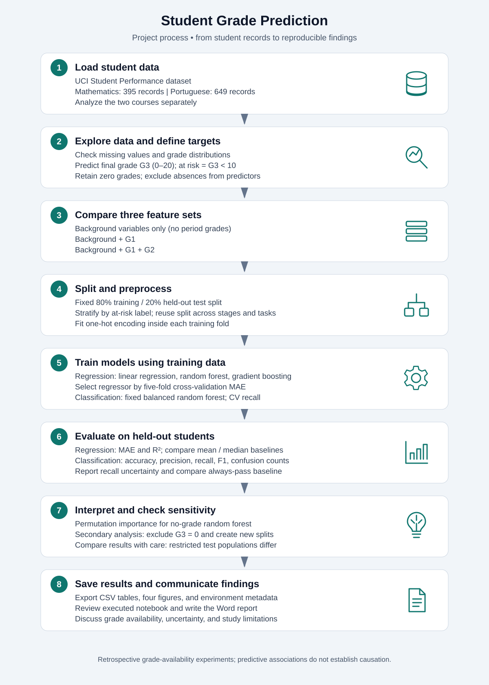

# Student performance project

Open `Student_grade_convention.ipynb` for the analysis and `Residency_Paper.docx` for the report. Original submissions are preserved under `review_outputs/`.

## Project process



## Reproduce

Verified with Python **3.13.1**. From this folder:

```sh
python3.13 -m venv .venv
source .venv/bin/activate
python -m pip install -r requirements.txt
jupyter notebook Student_grade_convention.ipynb
```

Restart the notebook kernel and run all cells in order. Keep `student-mat.csv` and `student-por.csv` beside the notebook. The notebook writes CSV tables, PNG figures, and `environment.json` into `review_outputs/`. The Word report is a static report corresponding to the supplied executed notebook; changing analysis settings requires updating its tables, images, and narrative too.

## Analysis choices

- Retain zero final grades; their meaning is not established by a dropout label.
- Exclude absences because prediction-stage attendance snapshots are unavailable.
- Treat stages as retrospective grade-availability experiments, not verified start-of-year forecasts.
- Stratify the 80/20 split by G3 < 10 and share the split across tasks and stages.
- Fit one-hot encoding within training folds. Select regressors with training-only five-fold MAE.
- Report held-out regression metrics, constant baselines, classification precision/recall/F1, confusion matrices, and recall intervals.
- Include a secondary G3 > 0 sensitivity analysis. Its population and test students differ from the primary analysis.

The supplied run used the pinned versions below; fixed seeds alone do not guarantee identical results across versions. `cross_validation.csv` reports training estimates; `regression.csv` and `classification.csv` report final held-out estimates. Do not tune models or thresholds against these test results.

## Submission formatting

The Word report uses double-spaced prose and one-inch margins. Check the final pagination and figure/table readability in Word or an exported PDF before submission: the 8–12-page limit cannot be verified from DOCX metadata. Confirm whether the instructor counts the title and reference pages.

Source: Cortez, P. (2008). *Student performance* [Data set]. UCI Machine Learning Repository. https://doi.org/10.24432/C5TG7T
